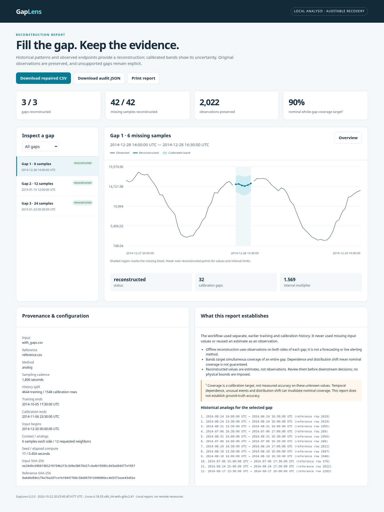

# GapLens

**Auditable offline reconstruction of missing monitoring data.**

[Source branch](https://github.com/dreamybu3/propro/tree/gaplens-delivery) · [Download source ZIP](https://github.com/dreamybu3/propro/archive/refs/heads/gaplens-delivery.zip)

Give GapLens an earlier history CSV and a later CSV containing gaps. It retrieves similar historical trajectories, aligns them to the observed gap boundaries, and exports estimated values, empirical uncertainty bands and an explanation of their provenance. Original measurements remain unchanged; unsupported gaps remain explicitly unresolved.



This is a complete CPU-only Python product and an executed, reproducible research study. No API key, paid service, GPU or background server is needed. Open `results/v2/demo/report.html` for the already generated demonstration, or create your own below.

## Run the included demo

Use **Python 3.12**. Python 3.11–3.13 is declared supported by the package; actual execution was verified on Linux x86-64 with Python 3.12.14. The owner independently verified the v1 GitHub Actions jobs on **Ubuntu and Windows**. This does not establish performance on the owner's laptop. The commands below use portable dependencies and require no CUDA.

With [uv](https://docs.astral.sh/uv/), from the repository root:

```sh
uv sync --frozen
uv run gaplens repair --reference examples/reference.csv --input examples/with_gaps.csv --output my-repair --require-complete
```

Open `my-repair/report.html` in your browser. It contains gap selection, observed/reconstructed curves, uncertainty bands, reference neighbors and CSV/JSON export links. It makes no external resource requests. The output directory must be new; `--overwrite` explicitly replaces only the three GapLens artifacts.

For **Windows PowerShell without uv**, install Python 3.12 and run:

```powershell
py -3.12 -m venv .venv
.\.venv\Scripts\python.exe -m pip install --require-hashes -r requirements.lock
.\.venv\Scripts\python.exe -m pip install --no-deps -e .
.\.venv\Scripts\gaplens.exe repair --reference examples/reference.csv --input examples/with_gaps.csv --output my-repair --require-complete
Invoke-Item .\my-repair\report.html
```

On Linux/macOS, the equivalent environment executables are `.venv/bin/python` and `.venv/bin/gaplens`. See [the Russian walkthrough](docs/QUICKSTART_RU.md). Data and example inputs are bundled; only initial dependency installation needs package-network access. `uv.lock` and the hash-locked `requirements.lock` record exact dependencies.

The executed demo reconstructed **3 gaps / 42 hidden real values**, preserved **2,022 observations**, and wrote these actual artifacts:

- [Interactive report](results/v2/demo/report.html)
- [Repaired CSV](results/v2/demo/repaired.csv)
- [Audit JSON](results/v2/demo/report.json)

## Use your own CSV

Both files need `timestamp,value` columns, strictly increasing unique timestamps, the same regular cadence and matching sampling grid. Empty numeric cells denote missing observations; insert explicit rows for absent timestamps before using the generic repair command. Values must be numeric and finite when present.

```csv
timestamp,value
2025-01-01T00:00:00Z,12.4
2025-01-01T01:00:00Z,
2025-01-01T02:00:00Z,13.1
```

This small example shows the format; it is not enough data to calibrate a repair. Supply substantial earlier history and at least six observed samples on each side of an interior gap. **Every input timestamp must be later than every reference timestamp.** The reference's first 75% fits the model; its last 25% calibrates uncertainty. The hidden input values are never used for fitting or calibration. Timestamps without timezone offsets are interpreted as UTC for indexing.

```sh
uv run gaplens repair --reference history.csv --input incomplete.csv --output repair-output \
  --method analog --neighbors 12 --context 6 --max-gap 48 --alpha 0.1
```

Use a single line in PowerShell. `--method diverse` selects temporally separated historical windows; `--method linear` and `--method extra-trees` expose comparison methods. Default `analog` was retained by the frozen development-selection rule. Other options include `--calibration-fraction`, `--calibration-gaps` and `--seed`; `gaplens repair --help` lists all settings.

| Output | Purpose |
| --- | --- |
| `repaired.csv` | Timestamp, original value, output value, lower/upper bands, status and gap ID |
| `report.json` | Input hashes, split dates, configuration, gap decisions, calibration counts and historical neighbors |
| `report.html` | Self-contained interactive visualization and export links |

Boundary gaps, gaps longer than the configured limit, missing surrounding context and inadequate calibration support remain missing with an explanation. Predictions are never reused as observations. **Repair exports cannot be reimported** as either query or reference: use the original `timestamp,value` measurements with missing cells retained. Do not strip the export's provenance columns to bypass this check. Exit code 2 means invalid input/configuration; with `--require-complete`, exit code 3 means artifacts were exported but some gaps remain unresolved. Default exit 0 allows explicitly partial repair.

Hard limits are 200,000 rows per file, 32 MiB per file, 200 gaps and 32 supported distinct gap lengths per run. The default maximum gap is 48 samples. Very large non-default settings can cost much more than the included experiment. See [architecture and limits](docs/ARCHITECTURE.md).

## V2: corrected provenance and a larger, negative-result study

Version 0.2 fixes repair-export reimport (including blank CSV preambles),
duplicate headers, predictable export conflicts, unsupported-model reporting,
failed-refit validation and seasonal timestamp resolution. The original v1
branch, data and measurements remain preserved. Read the [change and correction
record](docs/v2/CORRECTIONS.md): a parser-only fix followed the first holdout
run; its original results remain available and no model tuning followed exposure.

The prospective [v2 protocol](docs/v2/PROTOCOL.md) covers **14 real streams,
six collections, eight conservative source groups**, three chronological origins
and three mask seeds. It executed **2,139 gaps, 23,529 method cases and 162,126
point predictions**, retaining refusals. Eleven outputs cover v1, linear,
ExtraTrees, raw retrieval, seasonal, Kalman, conditional trajectory PCA,
separated retrieval and calibration/selection ablations. Correlated channels
and repeated masks are not independent new systems.

On 1,008 primary-regime gaps, paired equal-series geometric MAE ratios were:

| Comparison | MAE ratio (below 1 favors numerator) | Series wins / losses |
| --- | ---: | ---: |
| Selected separated retrieval / v1 | **1.0453** | 4 / 10 |
| Fixed-k=12 separated retrieval / v1 | 1.0393 | 4 / 10 |
| V1 / linear | 1.1543 | 7 / 7 |
| V1 / tuned ExtraTrees | 0.9440 | 10 / 4 |

The proposed point-error hypothesis failed. Default `analog` remains the
development-selected v1 predictor; `diverse` is optional. These heterogeneous
results do **not** establish that analogs universally beat interpolation.
Recent calibration met its frozen aggregate criterion, but the apparent width
benefit was dominated by one extreme network calibration episode. Static/recent
interval service was 996/984 out of 1,008 primary gaps; unsupported cases remain
visible. No future 90% coverage guarantee is claimed.

See the [English technical report](docs/v2/RESEARCH_REPORT.md), [generated tables
and figures](results/v2/final/tables.md), [post-result sensitivity](results/v2/sensitivity),
[independent reviews](docs/v2/RESULT_REVIEW.md) and [validation evidence](docs/v2/VALIDATION.md).
From a Git checkout, replay the frozen study into new directories:

```sh
uv run python scripts/run_experiments_v2.py --output results/my-v2-run
uv run python scripts/summarize_v2.py --input results/my-v2-run --output results/my-v2-summary
uv run python scripts/verify_v2.py --input results/v2/benchmark --compare results/my-v2-run
```

The guarded experiment requires Git history to verify its freeze. ZIP downloads
still support installation, the product CLI, saved results and their analysis.

## Original v1 study — now development evidence

`AnalogBridge` implements historical context/calendar retrieval, endpoint-residual correction of neighboring trajectories, distance-weighted aggregation, and a local disagreement/novelty scale. A separate calibration layer uses the maximum standardized error of each whole gap and a finite-sample corrected quantile. The repository implements these mechanisms and their ablations; NumPy/pandas provide primitives and scikit-learn supplies the ExtraTrees regressor. These are established ingredients in a specific tested design, **not a claim to have invented imputation or conformal prediction**.

The fixed study used three real NAB streams, chronological 60/20/20 splits, three gap lengths and three mask seeds: **648 gaps and 3,888 method cases**, all executed. Selected macro results:

| Method | MAE / training IQR ↓ | Entire-gap coverage (90% target) |
| --- | --- | --- |
| Linear interpolation | 1.8248 | 90.74% |
| ExtraTrees residual baseline | 1.0269 | 85.19% |
| AnalogBridge | 0.8795 | 85.80% |

AnalogBridge lowered normalized error by **51.8% versus linear** and **14.4% versus ExtraTrees** in this study. The result is mixed: NYC taxi coverage was only **78.70%**, and adaptive intervals were **16.5% wider** than the constant-scale ablation. The full hypothesis failed. CPU-utilization intervals were often too wide to be operationally useful. Do not treat nominal coverage as a guarantee under time dependence or distribution shift.

The main Linux run took **99.86 seconds** and **259.18 MiB** cumulative peak process RSS; these are shared-machine measurements, not a hardware-independent benchmark. All three source streams are real; their evaluation gaps are artificially hidden observations. Performance on genuine unobserved outages is unknown. No test-set tuning, paper acceptance, users or production readiness is claimed.

Read the [full research report](docs/RESEARCH_REPORT.md), [fixed protocol](docs/PROTOCOL.md), [generated measurement tables](results/benchmark/tables.md), [raw results](results/benchmark) and [related work](docs/RELATED_WORK.md).

## Reproduce and test

```sh
uv run python -m pytest -q
uv run python scripts/run_experiments.py --config configs/benchmark.json --output results/reproduction
uv run python scripts/plot_results.py --input results/reproduction
uv run python scripts/summarize_results.py --input results/reproduction
```

Use a fresh results directory. The saved original run remains available for comparison; elapsed times and platform metadata will vary. For a fast integration check, `uv run python scripts/run_experiments.py --quick` uses a separately labeled smoke protocol and is not a replacement for the full experiment.

`uv run python scripts/fetch_data.py` downloads immutable, checksum-verified upstream CSVs and reproduces the bundled processed data. `uv run python scripts/make_demo.py --output another-demo` creates the deterministic demo in a new directory. Avoid regenerating over edited files; `--overwrite` is explicit.

Meaningful tests cover hidden-value leakage invariants, endpoint corrections, finite scales, calibration ranks, data errors, missing-context abstention, output preservation, HTML escaping, both baselines and independent reconciliation of all saved experimental predictions. Browser checks and exact validation evidence are in [VALIDATION.md](docs/VALIDATION.md). The owner independently verified that baseline GitHub Actions passed on Windows and Ubuntu; v2 validation is recorded separately in `docs/v2/VALIDATION.md`.

## Project map

- [`src/gaplens/`](src/gaplens): numerical core, calibration, validation, repair pipeline and reporting.
- [`configs/`](configs) and [`scripts/`](scripts): fixed experiments, data preparation and generated figures/tables.
- [`data/`](data) and [`examples/`](examples): attributed real data, checksums and runnable inputs.
- [`docs/DECISION.md`](docs/DECISION.md): comparison of exactly three project candidates.
- [`docs/SOURCES.md`](docs/SOURCES.md): ten verified primary research/software sources.
- [`docs/ARCHITECTURE.md`](docs/ARCHITECTURE.md): equations and component responsibilities.
- [`docs/LEARNING_GUIDE.md`](docs/LEARNING_GUIDE.md): explanations, interview questions and demo script.
- [`docs/PORTFOLIO.md`](docs/PORTFOLIO.md): evidence-based CV wording and paper roadmap.
- [`docs/STATUS.md`](docs/STATUS.md): completed work and continuation notes.

Code is MIT-licensed; preserve the separate [NAB notice](data/LICENSE-NAB.txt) and [third-party attributions](docs/THIRD_PARTY.md). This project was built with AI assistance. The repository owner should reproduce the study and understand the implementation before presenting it as their own work. The owner authorized source-code delivery through the separate `gaplens-delivery` branch; this does not constitute deployment, publication of a research paper, or activation of the cloud environment snapshot.
