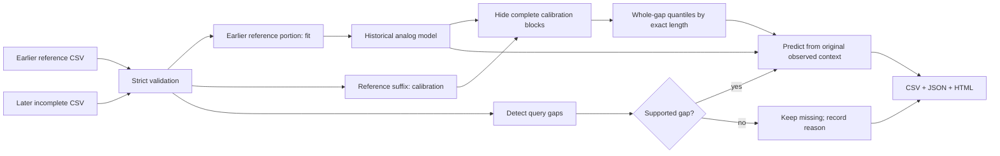

# Architecture and technical contribution

GapLens reconstructs a missing block in a **univariate, regularly sampled time
series after observations on both sides are available**. A separate earlier
history supplies analog trajectories and interval-calibration examples. The
output distinguishes observations, reconstructions, and unresolved gaps. It is
not a forecasting system, an online alerting system, or a replacement for the
original measurements.

The contribution implemented here is an inspectable combination of historical
context retrieval, endpoint conditioning, a local disagreement scale, and
whole-gap calibration, integrated into a provenance-preserving repair workflow.
Those ingredients have precedents. Their combination is a testable engineering
design, not an established claim of theoretical or publication-level novelty.
The fixed evaluation and falsification criteria are in [PROTOCOL.md](PROTOCOL.md).

## Modules and ownership of the computation

| Module | Responsibility |
| --- | --- |
| `src/gaplens/data.py` | Strict CSV validation and contiguous missing-run detection |
| `src/gaplens/core.py` | Historical window retrieval, bridge correction, local scale, linear baseline, and supervised ExtraTrees baseline wrapper |
| `src/gaplens/calibration.py` | Complete-window sampling, maximum standardized gap scores, and corrected order-statistic quantiles |
| `src/gaplens/pipeline.py` | Reference/calibration/query separation, abstention, observed-value invariants, output staging, and provenance |
| `src/gaplens/cli.py` | Configuration and actionable command-line errors |
| `src/gaplens/report.py` | Local HTML explanation of the exported repair and its uncertainty |
| `scripts/fetch_data.py` | Immutable source downloads, SHA-256 verification, and documented dataset-specific regularization |
| `scripts/run_experiments.py` | The fixed chronological comparison, case-level measurements, ablations, and execution metadata |

NumPy provides array operations; pandas provides CSV and timestamp handling;
scikit-learn supplies the actual ExtraTrees learner; Matplotlib renders research
figures. Python's standard library handles the CLI, HTTPS, hashing, JSON, paths,
and clocks. We do not claim to have authored these libraries, NAB observations,
ExtraTrees, nearest-neighbor methods, or conformal prediction. The custom
implementation is the retrieval/conditioning/scaling mechanism, split-safe
orchestration, abstention and audit contract, and experimental adaptation.



## AnalogBridge: the implemented equations

Let a query gap have length `L`, with `c` observed points on each side. Its
two-sided context vector `x` has `2c` entries. A historical candidate `j` consists
of a fully observed context `h_j` and interior trajectory `z_j,1 ... z_j,L`.
Only windows entirely contained in the fitted reference are eligible. Natural
missing values invalidate an entire candidate window. At most 4,000 candidates
are retained by deterministic, evenly spaced indices; the default neighbor count
is 12. This cap is a resource tradeoff, not an exact search over all available
history.

The reference normalization is:

```text
s = max(1.4826 × median(|reference − median(reference)|),
        population_std(reference), 1e−8)
```

Only finite reference values enter this expression. Because the maximum includes
the ordinary standard deviation, this is not a fully robust estimator under
arbitrary outliers; the code deliberately prevents either scale estimate from
making context distances excessively large. It is computed once from training
history, never from calibration or test values.

Each timestamp has sine/cosine features for daily phase and weekly phase. With
`d_day` and `d_week` denoting the squared Euclidean distance between those two
feature pairs at the candidate/query gap start, retrieval uses:

```text
d_j² = mean(((h_j − x) / s)²) + 0.15 × (d_day + 0.25 × d_week)
```

Calendar terms are omitted if timestamps are unavailable. Calendar phase is a
weak fixed preference, not a learned seasonal period. Distances are stably
sorted; the first `min(k, candidate_count)` windows receive normalized weights
proportional to `1 / (0.05 + d_j)²`. Ties therefore have deterministic resolution.

For interior position `i = 1 ... L`, define `t_i = i / (L + 1)`. Let `a,b` be the
query's nearest observed left/right values, and `a_j,b_j` the corresponding
historical endpoints. The bridge correction is:

```text
z'_j,i = z_j,i + (1 − t_i) × (a − a_j) + t_i × (b − b_j)
mean_i = Σ_j weight_j × z'_j,i
```

Equivalently, it transfers the historical deviation from its endpoint chord onto
the query's chord. This permits a similar historical shape at a different level
or slope to inform the missing interior. It does **not** constrain the interior
to a straight line or to physical value bounds. The anchors themselves are not
modified. The `no bridge` ablation uses the original historical interior instead.

For finite adjacent differences in training history, let `MAD_diff` be the median
absolute deviation about their median. The positive innovation floor is:

```text
sigma0 = max(1.4826 × MAD_diff / sqrt(2), 0.01 × s, 1e−8)
```

If no finite adjacent differences exist, the first term is zero. The relative
error scale combines neighbor disagreement and nearest-context novelty:

```text
variance_i = Σ_j weight_j × (z'_j,i − mean_i)²
scale_i = sqrt(variance_i + sigma0²) × sqrt(1 + min_j(d_j)²)
```

This scale has the same units as the signal. It is an uncertainty **proxy**, not a
standard error, posterior standard deviation, or coverage statement. A constant
signal still yields a positive numerical scale. The `constant scale` ablation
sets every `scale_i = sigma0` while keeping point predictions identical. Novel
contexts widen the proxy, but a large distance does not prove that it widens
enough under a new regime.

## Baselines and what is held constant

The simple baseline is endpoint linear interpolation. Its relative scale is
`sigma0 × sqrt((L + 1) × t_i × (1 − t_i))`, with a positive floor: a
Brownian-bridge-shaped heuristic rather than a fitted stochastic-process model.

The stronger CPU baseline is `ExtraTreesRegressor`: 64 trees with
`min_samples_leaf=3`, trained with one worker. Up to 600 complete historical gaps
are sampled across the requested lengths. Each hidden-point example uses the
two observed contexts, known calendar features, length, relative position,
`t_i(1−t_i)`, and the endpoint interpolation. It predicts the **residual** to that
interpolation. Its scale is the square root of tree prediction variance plus
`sigma0²`. Tree disagreement also requires external calibration; it is not
intrinsically a confidence interval.

All benchmark methods use the same gap locations, training/calibration/test
boundaries, and whole-gap calibration construction. No query interior value is
a feature. The benchmark additionally isolates endpoint correction, local scale,
and exact-length versus pooled calibration. ExtraTrees is a meaningful practical
baseline, not a claim that all state-of-the-art imputers were reproduced.

## Whole-gap uncertainty calibration

Calibration examples are complete blocks in the reserved reference suffix. Their
interiors are temporarily hidden from the predictor, then compared with their
known values. One score per gap is:

```text
score_gap = max_i(abs(truth_i − mean_i) / scale_i)
```

For `n` scores and target miscoverage `alpha`, sort the scores and choose the
`ceil((n + 1) × (1 − alpha))`-th smallest, using **one-based** indexing. If this
rank exceeds `n`, no finite calibrated band can be produced and the operation
reports insufficient support. For `alpha=0.1`, at least nine calibration gaps
are required merely to obtain a finite order statistic; more evidence is
preferable. The band is `mean_i ± quantile × scale_i`.

The maximum targets simultaneous coverage of the whole gap, which is harder than
pointwise coverage. A pointwise 90% interval does not imply 90% probability that
every point in a 24-sample gap is covered. Calibration is separate for each exact
gap length; the pooled-calibration ablation deliberately removes that distinction.

This is a split-conformal order-statistic construction. Its distribution-free
coverage theorem requires exchangeable gap examples. Chronological and
autocorrelated operational series do not establish that assumption. GapLens
therefore reports **empirical coverage**, without guaranteeing 90% future
coverage. Nonoverlapping windows reduce direct overlap within a sampling call;
they do not make a dependent time series independent or exchangeable.

## Three distinct data roles

For normal CLI use, `--reference` must end before `--input` begins. Both must
have the same cadence and sampling-grid phase. The default last 25% of reference
rows form the calibration suffix; the first 75% fit the model. User input is never
fitted, and its reconstructed values never become the context for other gaps.

The benchmark splits each full source series into 60% training, 20% calibration,
and 20% test. It uses the same separation principle with fixed benchmark
boundaries, rather than the CLI's two-file convenience split. Complete contexts
remain within each respective split. Artificially hidden real observations
provide ground truth; genuine missing source values never do. Overlapping masks
across seeds or lengths are explicitly allowed, so repeated seeds are a mask
sensitivity analysis rather than independent experimental replications.

## Abstention, errors, and audit boundaries

The workflow rejects malformed, unsorted, duplicate, irregular, infinite-valued,
oversized, overlapping, or incompatible-grid inputs. It does not silently fix
them. It preserves a gap as missing when the gap is too long, touches an edge
without enough context, has another missing value in its context, lacks historical
windows, or lacks adequate calibration. The JSON explains each refusal. A context
distance above three adds a review warning; it is **not** a validated rejection
threshold and does not automatically block reconstruction.

Every finite input observation is preserved numerically. Output `repaired.csv`
contains the original and repaired values, bounds, status, and gap identifiers;
bounds are absent on observed or unresolved rows. `report.json` records input
hashes, effective configuration, time boundaries, versions, runtime, per-gap
calibration counts/quantiles, and selected historical neighbor locations.
`report.html` explains these same exports locally. These records make a result
traceable; they do not certify its scientific correctness.

Output is staged before writing, and only the three documented artifact names
may be replaced with `--overwrite`. Final replacements are per-file, not a
transactional database commit. Source files cannot be selected as artifact
destinations. Without `--require-complete`, a successful export may contain
unresolved gaps; that flag returns exit code 3 if any remain. Invalid input or a
fatal operation error returns exit code 2. Successful repair/export returns 0.

## Resources and limits

There are no remote inference calls or GPU dependencies. Cached historical
candidate matrices are built lazily per requested length. Candidate comparison
cost scales with the number of retained candidates and context size; the current
stable full sort costs `O(M log M)`, and averaging the selected interiors costs
`O(kL)`. Historical eligibility scanning still touches the entire reference; the
4,000-candidate cap does not make preparation constant time. The strict CSV reader
limits input to 200,000 rows and 32 MiB, while the pipeline bounds context and gap
length. These are guardrails, not a universal memory guarantee.

Important unresolved risks are regime changes, nonrandom outages, dense adjacent
gaps, timezones with ambiguous source provenance, unseen physical constraints,
and extrapolation to domains absent from the three-series pilot. Review the
actual benchmark report before deciding whether analog reconstruction is
preferable to the simpler interpolation baseline for a particular domain.
