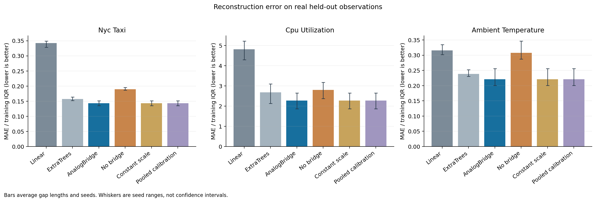
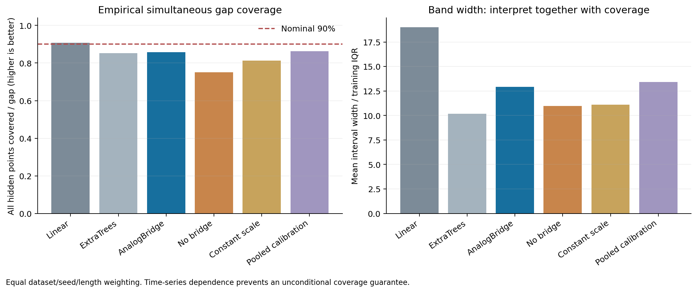
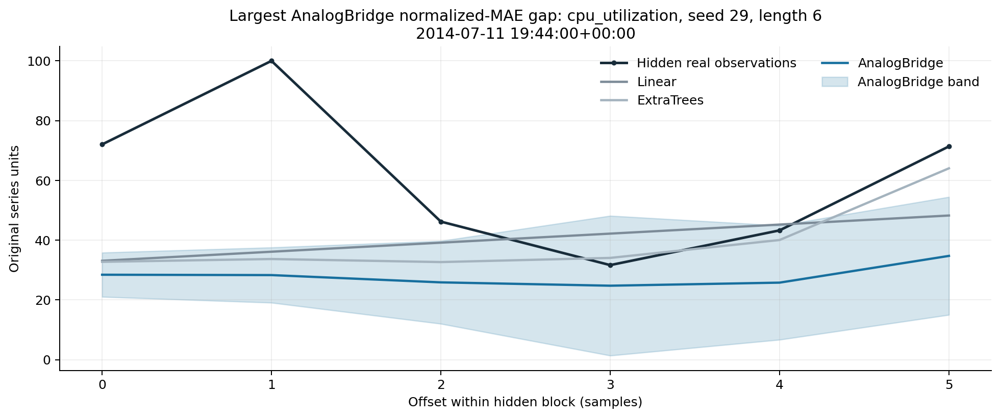

# GapLens: Auditable analog reconstruction of missing monitoring blocks

Technical report, version 0.1.0. This is an executed exploratory study, not a published or peer-reviewed paper. Code and writing were developed with an AI coding assistant; no claim is made about the repository owner's personal execution of this work.

## Abstract

Monitoring analysts often need to repair contiguous missing values after measurements on both sides become available. We implement AnalogBridge: retrieve complete historical windows by surrounding context and calendar similarity, align each candidate to the observed endpoints, average the corrected trajectories, and calibrate a local error scale using whole-gap maximum residuals. A usable CSV-to-CSV/JSON/HTML product exposes reference provenance and refuses unsupported repairs. On three real NAB streams with artificially hidden blocks, a fixed chronological evaluation of 648 gap cases found 51.8% lower macro train-IQR-normalized MAE than linear interpolation and 14.4% lower than an ExtraTrees residual regressor. However, empirical whole-gap coverage was 85.8% at a nominal 90%, falling to 78.7% for NYC taxi. Adaptive bands were wider than the constant-scale ablation, contradicting the width hypothesis. This supports further investigation of reconstruction quality, while exposing serious limits of static uncertainty calibration under temporal shift.

## 1. Problem, related work and contribution

The intended user is an analyst preparing a monitoring series for retrospective analysis. Inputs are a strictly earlier historical CSV and a later regularly sampled CSV with missing values. Outputs preserve observed measurements, label reconstructed versus unresolved values, include uncertainty bands, and expose historical neighbor timestamps. This is offline smoothing/reconstruction: the right context is allowed. It is neither forecasting nor live failure detection, and estimates must not replace evidence of a failure without review.

Univariate interpolation, seasonal and Kalman methods already exist in imputeTS [S2]. ImputeGAP [S3] already provides extensive repair, pattern-search, missingness and benchmarking facilities. BRITS and SAITS [S4,S5] use learned temporal/multivariate structure; CSDI [S6] already performs probabilistic imputation. EnbPI, the conformal tutorial and MAPIE [S7–S9] establish relevant uncertainty methods and limitations. We therefore do not claim that imputation, analog retrieval, uncertainty bands or a repair interface are new. See [RELATED_WORK.md](RELATED_WORK.md) and the ten verified [primary sources](SOURCES.md).

The original artifact is the explicit, tested AnalogBridge mechanism, its whole-gap calibration implementation, and the auditable product/evaluation path. The contribution is a specific method/system design and measured component tradeoffs. Scikit-learn supplies the ExtraTrees learner [S10]; NumPy/pandas supply numerical and tabular primitives; the source signals belong to NAB and its attributed providers [S1]. No existing imputation repository was copied. Broad algorithmic novelty remains unestablished.

## 2. Question and pre-experiment hypothesis

Can endpoint-conditioned historical analogs provide a useful error/CPU/uncertainty tradeoff for offline missing-block reconstruction?

The [fixed protocol](PROTOCOL.md) and [configuration](../configs/benchmark.json) were saved before the main run. They set four criteria: at least 10% lower macro normalized MAE than linear; no more than 10% higher MAE than ExtraTrees; empirical whole-gap coverage at least 85% at a nominal 90%; and narrower bands than the constant-scale ablation. These are local exploratory thresholds, not preregistration or evidence of significance. The test set was not used to tune parameters, choose winners, or remove datasets. A preliminary implementation check used NYC observations wholly within the later-designated training partition.

## 3. Method

For a gap of length L, six observed values on each side form the context vector. Complete reference windows are indexed separately for each L; at most 4,000 are selected deterministically across history. Candidate distance combines squared context differences normalized by a reference std/MAD scale, daily cyclical features and quarter-weighted weekly cyclical features. Calendar weight is fixed at 0.15. The 12 nearest windows receive weights proportional to `(0.05 + distance)^(-2)`.

For each candidate trajectory a(j), its adjacent anchors a_left,a_right are aligned to query anchors y_left,y_right:

```text
t_j = j / (L + 1), j = 1,...,L
corrected_a(j) = a(j) + (1-t_j)(y_left-a_left) + t_j(y_right-a_right)
prediction(j) = weighted mean of corrected_a(j)
scale(j) = sqrt(weighted disagreement(j) + innovation_floor²)
           * sqrt(1 + nearest_context_distance²)
```

The innovation floor uses training first differences and remains positive for constant signals. This relative scale is not a calibrated probability. On a disjoint later calibration split, each gap supplies `max_j |truth(j)-prediction(j)|/scale(j)`. The `ceil((n+1)(1-alpha))`-th order statistic gives q for each exact length, and the final band is `prediction ± q*scale`. Too few calibration examples produce abstention, not a guessed quantile. The protocol uses alpha=0.1 and 24 calibration gaps per length.

The finite-sample conformal construction requires exchangeable examples for its usual coverage guarantee. Chronological, dependent operational data do not establish that condition. Here the bands are empirical uncertainty estimates; neither a statistical theorem for this setting nor a guarantee of future 90% coverage is claimed. Full formulas and module boundaries are in [ARCHITECTURE.md](ARCHITECTURE.md).

## 4. Data and experimental design

Data come from the official Numenta/NAB repository at commit `ea702d75cc2258d9d7dd35ca8e5e2539d71f3140`, under its inspected MIT license. Source SHA-256 hashes, license notice, URLs and original-provider attribution are in [data/manifest.json](../data/manifest.json) and [data/README.md](../data/README.md). No artificial NAB streams are used. Native source clock times have no stated timezone; UTC is an indexing convention, not a geographic timezone assertion.

| Series | Source observations | Regular-grid rows | Native missing | Cadence | Gap durations for L=6/12/24 |
| --- | --- | --- | --- | --- | --- |
| NYC taxi passengers | 10,320 | 10,320 | 0 | 30 min | 3 / 6 / 12 hours |
| AWS CPU utilization | 18,050 | 18,050 | 0 | 5 min | 30 / 60 / 120 minutes |
| Office ambient temperature | 7,267 | 7,888 | 621 | 1 hour | 6 / 12 / 24 hours |

Missing ambient timestamps are explicitly inserted as NaN; values are never interpolated during dataset preparation. Native missing values cannot supply ground truth and are excluded from masked cases. Anomaly labels are not used as imputation truth or to select favorable periods.

Each series is divided chronologically 60% training, 20% calibration, 20% testing. Every gap plus both contexts stays wholly inside its own split. For seeds 17,29,43 and lengths 6,12,24, the protocol selects 24 nonoverlapping complete windows per split and length. All methods receive the same masks. A case masks one gap at a time: this is not a benchmark of simultaneous dense outages. Windows may overlap across lengths and seeds, so 648 cases are not 648 independent systems. Repeated seeds measure mask sensitivity, not independent replications.

The simple baseline is endpoint linear interpolation. The stronger practical baseline is a 64-tree ExtraTrees regressor trained on up to 600 masked reference gaps to predict residuals to interpolation, using the same available contexts and calendar information. Three ablations remove endpoint correction, replace adaptive scale by a constant training scale, or pool calibration scores across lengths. This is not a comparison against state-of-the-art learned imputation, TKCM or Kalman smoothing.

Metrics include MAE, RMSE, MAE normalized by training IQR, point coverage, simultaneous whole-gap coverage, mean band width and a pointwise interval score. Macro results weight each series, seed and length equally. The pointwise interval score is not a specially derived score for joint gap bands. Timing and cumulative process RSS are recorded; no GPU or external model/API is used.

## 5. Executed results

The definitive run `26ff839c-11c3-4576-b64c-3e104315b402` completed all 648 gap cases, 3,888 method cases and 54,432 predicted points. Full numeric predictions, case metrics, configuration, package/code/data hashes, split timestamps and logs are retained in [results/benchmark](../results/benchmark). An independent test recomputes MAE, coverage and width from the saved point predictions and checks interval-only ablations preserve point predictions.

<!-- BEGIN GENERATED TABLES -->

<!-- Generated by scripts/summarize_results.py; run 26ff839c-11c3-4576-b64c-3e104315b402 -->

Equal weight is assigned to each series, seed and gap length. Raw per-series errors are in source units; do not average those units. Nominal whole-gap coverage is 90%.

| Method | MAE / training IQR ↓ | Whole-gap coverage | Width / training IQR ↓ | Warm prediction ms/gap |
| --- | --- | --- | --- | --- |
| Linear | 1.8248 | 90.74% | 19.012 | 0.254 |
| ExtraTrees | 1.0269 | 85.19% | 10.172 | 12.860 |
| AnalogBridge | 0.8795 | 85.80% | 12.920 | 2.079 |
| No endpoint bridge | 1.0989 | 75.15% | 10.968 | 1.985 |
| Constant scale | 0.8795 | 81.33% | 11.087 | 1.942 |
| Pooled calibration | 0.8795 | 86.27% | 13.407 | 2.079 |

| Series | Linear MAE | ExtraTrees MAE | AnalogBridge MAE | Analog gap coverage | Analog mean band width |
| --- | --- | --- | --- | --- | --- |
| ambient_temperature | 1.445 | 1.089 | 1.008 | 85.65% | 5.941 |
| cpu_utilization | 15.390 | 8.581 | 7.270 | 93.06% | 116.984 |
| nyc_taxi | 3030.488 | 1390.475 | 1265.482 | 78.70% | 7529.480 |

AnalogBridge mask-seed range: normalized MAE 0.7368–1.0161; gap coverage 79.63%–90.74%. These are sensitivity ranges, not confidence intervals.

<!-- END GENERATED TABLES -->



The macro normalized-MAE reductions are 51.8% versus linear and 14.4% versus ExtraTrees. Improvements also occur separately on all three selected series, so the direction is not solely a cross-unit aggregation artifact. Nevertheless, the CPU training IQR is only 3.1955, making its normalized errors and widths numerically dominant even with equal series weights. Per-series raw metrics are essential; the macro magnitude should not be generalized to arbitrary monitoring data.

Endpoint bridging reduces normalized MAE by 20.0% relative to the no-bridge ablation. Adaptive scaling raises gap coverage from 81.33% to 85.80%, but increases normalized width by 16.5% (11.087 to 12.920). Thus **the narrower-band criterion fails and the full hypothesis is not supported**. The fixed 85% empirical threshold is met in aggregate, but does not establish the nominal 90% target or reliability within each series. Pooled calibration yields 86.27% coverage and width 13.407: this small tradeoff does not establish that exact-length calibration is superior. ExtraTrees has a better aggregate pointwise interval score and narrower bands; the proposed method is not uniformly best.



## 6. Failure analysis and resource use

NYC taxi whole-gap coverage is only **78.70%**, despite 94.04% point coverage. Simultaneous coverage is harder because one missed point fails a whole gap; averages can conceal this failure. Static calibration is vulnerable to shifted dynamics and an incomplete history of uncommon patterns. These plausible explanations require controlled follow-up; the current experiment does not identify a causal explanation for every miss.

The largest normalized AnalogBridge error is an AWS CPU six-point gap (seed 29, source start index 16926). Observed context resembles ordinary history (nearest distance 0.272), while the hidden values include a jump to 100. Predictions remain around 25–35. Similar endpoints cannot reveal an interior burst. Consequently, a small neighbor distance is **not** a reliability guarantee. The saved [worst_cases.csv](../results/benchmark/worst_cases.csv) and figure retain this failure rather than selecting only successful examples.



CPU mean interval width is approximately 116.98 source units, greater than the conventional 0–100 utilization range. Intervals are not physically clipped; their width is a genuine warning of limited usefulness. Clipping or changing the method after viewing these tests would require a new predeclared study and independent holdout.

The run took 99.86 seconds with 259.18 MiB cumulative peak process RSS on Linux x86-64, Python 3.12.14. Warm AnalogBridge prediction averaged 2.079 ms/gap versus 12.860 ms for ExtraTrees. Candidate-cache construction occurs during calibration and is included in separate calibration timings, not the analog `fit()` time. ExtraTrees fit timings ranged 1.75–44.19 seconds amid shared-machine load. These are observed engineering measurements, not a controlled performance benchmark. Neither Windows nor the user's GTX 1660 Ti was tested; GPU support is unnecessary. The measured memory use is comfortably below 16 GB for this experiment, not a bound for arbitrarily large inputs.

## 7. Product validation and reproducibility

The actual demo reconstructs 3/3 gaps (42 hidden real NYC samples), preserves all 2,022 observed input values and exports [CSV](../results/demo/repaired.csv), [audit JSON](../results/demo/report.json) and [interactive HTML](../results/demo/report.html). The demo ground truth is a separate file never read by the repair pipeline. Its small hand-defined mask schedule is a demonstration, not additional independent evidence for the research hypothesis.

Tests cover hidden-value invariance, disjoint history, finite scales, deterministic algorithms, calibration rank, missing-context abstention, input errors, observed-value preservation, protected output paths, HTML escaping, baseline integration and saved-result accounting. Exact executed checks and browser status are documented in [VALIDATION.md](VALIDATION.md). The Windows/Linux CI workflow is supplied, but remote CI has not been run or published.

From the project root with the environment installed:

```sh
python -m pytest -q
gaplens repair --reference examples/reference.csv --input examples/with_gaps.csv --output my-repair --require-complete
python scripts/run_experiments.py --config configs/benchmark.json --output results/reproduction
python scripts/plot_results.py --input results/reproduction
python scripts/summarize_results.py --input results/reproduction
```

Bundled processed data allow offline modeling after package installation. `python scripts/fetch_data.py` independently refreshes verified upstream bytes without weakening checksums or TLS. The main dataset download/preprocessing was tested both from an empty temporary directory and from the existing cache.

## 8. Limits and path toward a paper

Only three selected streams, one temporal split and three related mask repeats are studied. Missingness is artificially imposed on observed complete windows, not genuine missing-not-at-random ground truth. Durations differ across series; context6 has different physical meaning. The selection of finite windows may underrepresent difficult real outages. There is no multivariate evaluation, no learned modern imputation comparison, no user study, no downstream benefit study and no distribution-free temporal coverage result. No statistical significance or publication outcome is claimed.

A useful next paper question is whether shift-aware retrieval and rolling calibration can improve **conditional whole-gap coverage** without excessively broad intervals. Evidence needed: many independent streams and rolling origins; compatible TKCM/Kalman/seasonal and probabilistic baselines; development-only parameter selection; interval calibration by shift/gap duration with held-out evaluation; dense/MNAR/context-corrupted outages; block-respecting uncertainty estimates; native Windows / 16 GB resource measurements and a downstream analyst study. The present run establishes executable infrastructure, measured point-error improvements on a small test bed, and a documented uncertainty failure worth investigating. See [LEARNING_GUIDE.md](LEARNING_GUIDE.md) for an ownership-safe study and demonstration plan.
