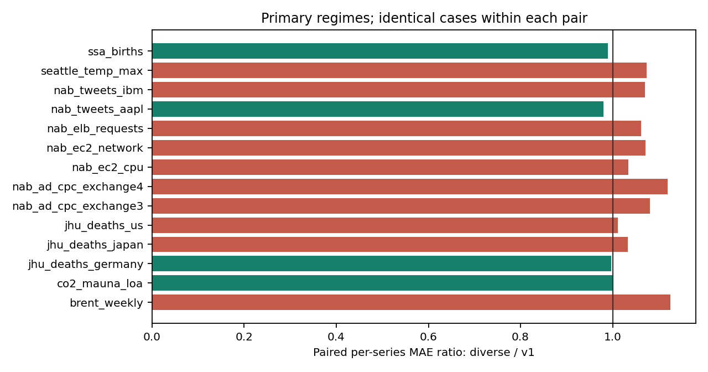
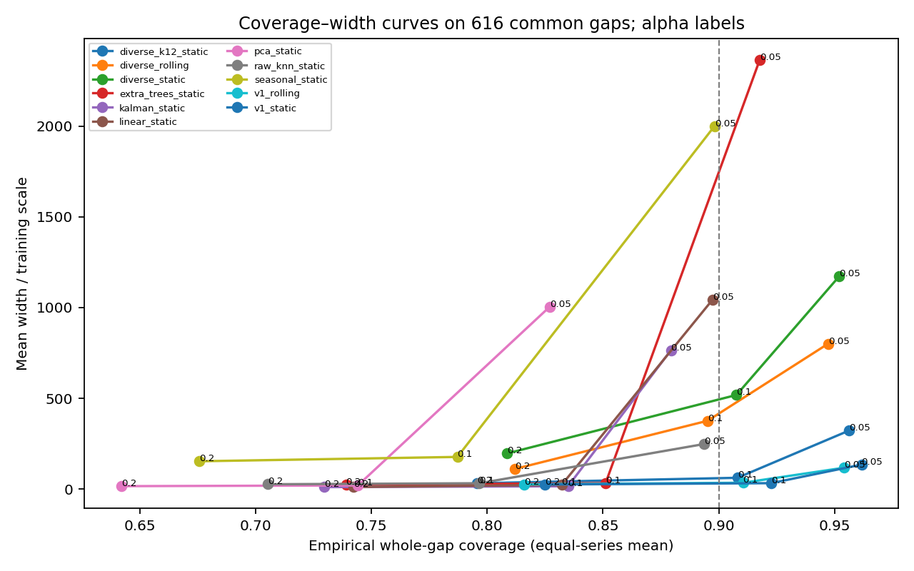
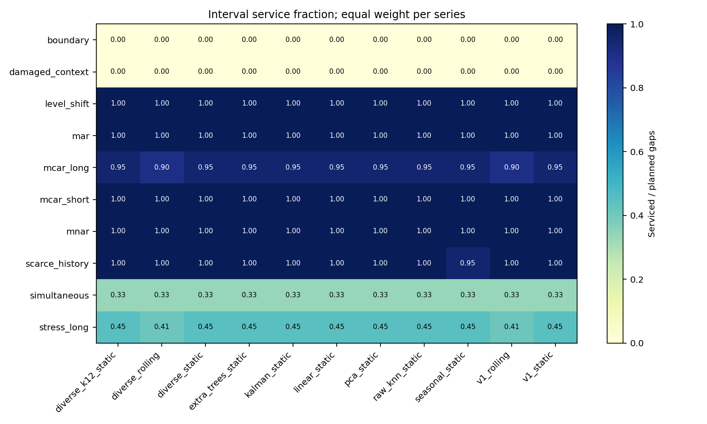
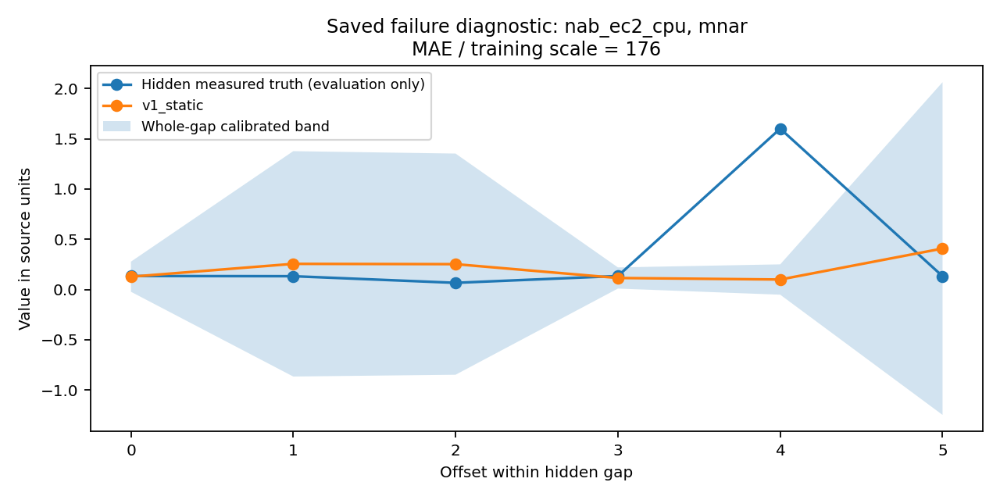

# GapLens v2: an auditable study of retrospective block imputation and whole-block uncertainty

**Status:** English technical-report draft; not a peer-reviewed paper, an established novelty claim, or a claim of state-of-the-art performance. The prospective numerical protocol and analysis were frozen at commit `dc43d47` before new-series scoring. [Freeze evidence](FREEZE.md), [protocol](PROTOCOL.md), [source ledger](SOURCES.md) and [generated results](../../results/v2/final/tables.md) distinguish design decisions from observations. The preserved v1 checkpoint is `ecf22de604d14e747bf6607d50b62b4870d24fcf`.

## Abstract

We evaluate a provenance-safe CPU tool for retrospective univariate block imputation, combining historical analog retrieval, boundary correction and whole-block residual calibration. A protocol frozen before final scoring compares 11 method/calibration outputs on 14 real streams from six collections and eight conservative source groups, with 2,139 planned targets and 1,008 primary-regime gaps. The proposed temporal separation fails its point-error hypothesis: the selected candidate's equal-series geometric MAE ratio to unchanged v1 is **1.0453** (four series wins, ten losses; exploratory source-group 95% interval **1.0199–1.0744**). V1 itself is heterogeneous: its ratio to linear is **1.1543**, including a severe network-stream failure, despite ranking well on many other streams. Recent calibration moves v1 macro whole-gap coverage from **92.635% to 90.948%** on 982 common supported gaps and formally meets the frozen aggregate uncertainty criterion; however, the large normalized mean-width change is dominated by one calibration extreme, and common-support curves do not show a uniform efficiency benefit. V1/static, selected before final scoring, remains the product default. This is an empirical study of known mechanisms with reproducible failures and explicit abstention, not a new imputation or coverage theorem. A later parser correctness fix and replay are disclosed as corrected analysis after the first holdout exposure.

## 1. Motivation and scope

Missing monitoring data are often reconstructed retrospectively, after measurements on both sides of an outage are available. In this setting an imputation system needs more than a low average error: it must distinguish measurements from estimates, preserve original observations, explain unsupported cases and describe uncertainty for an entire missing block. Pointwise 90% intervals need not cover all values in a block, and an algorithm that silently refuses difficult cases can appear artificially accurate.

GapLens is a CPU-based research prototype for regularly sampled univariate CSV data. Its AnalogBridge predictor retrieves similar historical windows using the observed context on both sides, corrects each historical trajectory toward the query boundaries, and combines the adjusted trajectories. A calibration layer converts a relative uncertainty scale into a rectangular band for the whole gap. The v2 study asks whether temporal separation of retrieved windows and more recent calibration improve this combination. The two changes are tested separately, and a negative result is an acceptable outcome.

The intended contribution is a reproducible evaluation and an auditable implementation of established ideas, together with a concrete provenance fix. Historical analogs, residual correction, non-overlapping pattern selection, retrospective smoothing and conformal scores all have prior art. We do not infer novelty from an independent implementation or a new name. We also do not claim that a finite benchmark settles the best method for all time series.

## 2. Problem and information contract

Let `y_1,...,y_N` be a scalar series on a strictly increasing, constant-duration timestamp grid. A target gap is the half-open interval `[a,b)`, with length `L=b−a`. The observed local context is the `c` measurements immediately before `a` and the `c` measurements starting at `b`. A historical reference precedes the evaluation region. The predictor estimates the hidden vector and may provide a simultaneous band; it must refuse unsupported reconstruction rather than invent observed context.

All compared predictors receive the same training prefix, timestamps and exactly those two local context blocks. The runner masks every other query value before invoking the predictor. Right context is allowed because this is offline reconstruction, not forecasting. If another simultaneous outage removes a required context value, its hidden truth is unavailable to every method. Repairing one target to provide another target's context is prohibited. Pointwise or whole-block evaluation truth is accessible only to the explicitly defined mask generator and evaluator, never to model fitting or prediction.

The benchmark distinguishes **point availability** from **interval service**. A research method can return a finite point estimate while calibration has insufficient support for a finite target-coverage band. Such an estimate contributes to paired point-error comparisons but is not a serviced product reconstruction. The public repair pipeline requires the supported interval and records a refusal otherwise. We report both denominators and accepted-and-covered cases divided by all planned cases.

### 2.1 Provenance-safe product behavior

The confirmed v1 defect occurred when a generated `repaired.csv` was passed back as input: reading only `value` silently promoted 42 previous estimates to observations and discarded their intervals. V2 chooses an explicit format contract. Annotated repair exports containing reserved provenance/output fields are rejected as either input or historical reference, with an explanation to use the original measurement CSV. A new hole added to an annotated export does not make that file acceptable. This avoids guessing provenance or allowing estimates to become training targets, calibration truth or measured context.

This contract does not recover provenance from an arbitrary two-column file after someone has removed all metadata. Such a file cannot reveal which numeric values are measured. Users must retain the original measurements and the annotated output separately. Product validation, timestamp/resource handling and regression evidence are documented in [PRODUCT_AUDIT.md](PRODUCT_AUDIT.md) and the final validation record. The immutable v1 numerical comparator is retained separately from corrected public-product code.

## 3. Related work and originality assessment

TKCM (Wellenzohn et al., 2017) is particularly relevant. Its inspected attributed C++ adaptation compares historical patterns in reference channels and uses dynamic programming to select non-overlapping patterns before averaging associated target values. This directly precedes temporal diversity in pattern-based imputation. We could not obtain the original paper/author download in this environment; the evidence and access limitation are explicit in [SOURCES.md, R1](SOURCES.md#r1--tkcm-non-overlapping-historical-pattern-imputation). GapLens's greedy univariate bidirectional block retrieval is not an exact TKCM reproduction. STUMPY's implementation also explicitly suppresses an exclusion zone after each selected match.

AnDA (Lguensat et al., 2017) combines a historical catalog with local-constant, local-incremental or local-linear analog forecasting and ensemble data assimilation. The incremental operator adds historical changes to the current state, and its ensemble Kalman smoother uses later observations. These mechanisms establish close prior art for analog correction and retrospective reconstruction; AnDA's original Lorenz-system experiments do not establish performance on this corpus.

SSA gap filling provides another close alternative. Rssa's author implementation combines forecasts from the left and right with linear weights or reconstructs missing entries through trajectory-subspace projections, citing Golyandina and Osipov (2007). DynaMMo's original author code (Li et al., 2009) fits a latent linear dynamical system using forward/backward expectations and repeated missing-entry estimates. Our conditional trajectory PCA shares a low-rank motivation, but neither reproduces SSA's full trajectory reconstruction nor DynaMMo's latent transition model.

Kalman smoothing is already a practical univariate imputation baseline in imputeTS (Moritz and Bartz-Beielstein, 2017). Analog ensembles also use historical analog outcomes for probabilistic prediction (Delle Monache et al., 2013; inspected through PAnEn). These methods do not require GapLens's particular nearest-window mechanism; their information requirements must be made explicit in comparisons.

For uncertainty, EnbPI (Xu and Xie, 2021) uses bootstrap-ensemble residuals with sequential feedback, and SPCI (Xu and Xie, 2023) predicts conditional residual quantiles from residual history. Their dependent-data results require specified assumptions; a recent empirical block-score quantile is neither algorithm. CFRNN (Stankevičiūtė et al., 2021) explicitly distinguishes individual and joint trajectory coverage and uses a different, Bonferroni-based horizon correction. The detailed [method comparison](RELATED_WORK.md) separates mechanisms, information availability and verified limitations. This review supports an empirical combination study, not an established new imputation or coverage theorem.

## 4. Predictors and calibration

### 4.1 Historical analog reconstruction

A complete historical candidate contains `c` left-context values, `L` target values and `c` right-context values. Candidate distance is the square root of the mean squared training-scaled context difference plus the unchanged v1 calendar penalty when timestamps are supplied. Without that penalty it is a training-scaled root-mean-square context difference; the square root matters because weights use the resulting distance directly. At most 4,000 candidates are retained at evenly spaced start indices. V1 selects the 12 nearest candidates; distance weights are proportional to `(0.05+d_j)^−2` and normalized to sum to one.

For historical trajectory `a_j(t)` with endpoints `a_j,left` and `a_j,right`, and query endpoints `q_left,q_right`, the adjusted trajectory is

```text
u_t = t / (L + 1),                 t = 1,...,L,
a'_j(t) = a_j(t)
          + (1 − u_t)(q_left − a_j,left)
          + u_t(q_right − a_j,right),
mean(t) = sum_j w_j a'_j(t).
```

This affine residual correction uses the two observed boundaries. The relative scale combines weighted disagreement among adjusted trajectories, a positive training-derived innovation floor, and inflation by the nearest context distance. It is an uncertainty heuristic requiring calibration, not a standard error from independent neighbors. Full implementation details and numerical tests are in the source; v1's fixed distance/calendar assumptions are retained rather than retuned on final data.

The separated variant ranks candidates exactly as v1 and greedily accepts a candidate only when its full `2c+L` window does not overlap any previously accepted window. It can return fewer than the requested number of neighbors and never fills the set with overlapping replacements. Temporal separation does not establish independence. Its possible benefit—avoiding many near-duplicates from one episode—competes with the cost of rejecting good matches.

### 4.2 CPU competitors and controlled ablations

| Predictor | Mechanism and role |
|---|---|
| Linear | Straight line between observed endpoints; a necessary low-complexity control. |
| Literal v1 | Immutable original AnalogBridge numerical implementation, evaluated on the new protocol. |
| Raw context KNN | Same historical-context retrieval without the endpoint correction; isolates the bridge mechanism. |
| ExtraTrees | Training-window features predict residuals around the interpolation chord; uses the same query context. |
| Seasonal profile | Training-only phase medians at a metadata-specified period, shifted by the mean observed-context residual. |
| Local-linear Kalman/RTS | A two-state level/slope model; training-derived noise scale and tuned process ratio; forward filtering followed by backward smoothing on the same local context. It is not maximum-likelihood imputeTS or a full seasonal state-space search. |
| Conditional trajectory PCA | Training-only low-rank complete-window subspace; ridge estimation of latent coordinates from the observed left/right entries. |
| Separated analog, selected k | Proposed retrieval adaptation with development-selected `k`; compared with unchanged v1. |
| Separated analog, k=12 | Fixed-neighbor-count ablation that isolates temporal exclusion from changing `k`. |

For PCA, let `B_O` and `B_M` be the observed and missing rows of the learned PCA basis and `m` the training-window column mean, in training-normalized units. The implementation solves

```text
z = solve(B_O.T B_O + ridge I, B_O.T (query_O − m_O)),
prediction_M = m_M + B_M z,
```

then restores original units. This is regularized subspace reconstruction, not conditioning with the full empirical Gaussian covariance or maximum-likelihood probabilistic PCA. Its training reconstruction RMS plus innovation floor also requires calibration. It challenges the need for explicit nearest-neighbor retrieval with a learned global context-to-target relation.

No neural baseline was run. The comparison is scoped to small-data univariate CPU reconstruction with fixed local context. This omission rules out broad superiority claims over modern neural or foundation-model imputers; it is not evidence that those approaches are unsuitable or inaccurate.

### 4.3 Whole-block intervals

For calibration block `i`, define

```text
S_i = max_t |truth_i(t) − mean_i(t)| / scale_i(t),
r = ceil((n + 1)(1 − alpha)),
q = r-th smallest calibration score,
band(t) = [mean(t) − q scale(t), mean(t) + q scale(t)].
```

The maximum makes the block the prediction object. Under exchangeability of calibration and new **block scores**, the usual rank argument supports marginal block coverage; temporal dependence inside a block is not the same issue as exchangeability between blocks. Our time-series blocks and shifts do not establish the latter assumption, so nominal 90% remains an empirical target. Non-overlapping calibration windows reduce direct reuse but do not prove independence. If `r>n`, the implementation refuses a finite interval instead of lowering the quantile or duplicating scores. At `alpha=0.1`, at least nine usable scores are needed.

Static calibration uses the 40–60% segment. Recent calibration uses the 20% segment immediately preceding each evaluation origin, while point-model fitting stays frozen at the first 40%. Both use up to 32 disjoint complete gap-plus-context windows per length. This is recent-history recalibration at predefined origins, not an online algorithm receiving every preceding hidden test target as feedback. For the simultaneous-outage history chain, previously hidden values remain masked at later origins. Isolated counterfactual masks are separate scenarios. No repaired estimate becomes calibration truth.

The primary four-cell ablation is v1/static, v1/recent, selected-separated/static and selected-separated/recent. Saved predictions are checked to establish that calibration changes intervals while leaving point predictions unchanged.

## 5. Prospective study design

### 5.1 Development and final evidence

The three already-inspected v1 streams—NYC taxi, CPU utilization and ambient temperature—are development data only. They retain their original files/results. Development tuning used 96 shared masked cases and 1,536 configuration/case measurements; no new-series error or model prediction was inspected before freezing the final protocol, configurations, masks and analysis.

Four families received three configurations each: separated `k∈{4,8,12}`; ExtraTrees with 32/64/96 trees and 300 training gaps; Kalman process ratio 0.01/0.1/1; PCA rank/ridge pairs (2,0.01), (4,0.1), (8,1). V1, raw KNN, linear and the metadata-defined seasonal control were fixed. This is a disclosed modest budget, not exhaustive tuning; PCA rank and regularization are varied jointly. The objective is the geometric mean of per-series MAE ratios to linear, with deterministic tie-breaking and failures making a configuration ineligible.

Selections were `k=4`, 32 trees/300 gaps, process ratio 0.01 and PCA rank 4/ridge 0.1. ExtraTrees was the development-selected non-retrieval competitor. Separated retrieval's development ratio to v1 was **1.03994**, so it failed the predeclared 5% improvement gate. Consequently **v1/static was frozen as the product default before final scoring**. Final outcomes are not allowed to choose a different default or retune a predictor.

The prospective H1 criterion requires the separated candidate's equal-series geometric mean MAE ratio to v1 to be at most 0.95 and its ratio to the development-selected competitor to be below one. H2 separately requires recent calibration of the same predictor to move equal-series mean whole-gap coverage closer to 0.90 without increasing common-case mean normalized width by more than 10%. Mean per-series absolute coverage deviation is also reported because overcoverage and undercoverage can cancel in a macro average. These are effect criteria, not statistical coverage guarantees.

### 5.2 Data and provenance

The corpus contains **14 distinct scalar streams from six release collections, eight conservative provider/domain groups and 12 labeled observation-system groups**. The labels are not an independence proof: three AWS metrics have unknown asset linkage; JHU countries share pandemic/reporting conditions; tickers share Twitter; advertising exchanges share possible market shocks. Seven final streams use the NAB release also used for development, so source-release separation is incomplete even though the signals are distinct.

| Streams | Cadence | Rows per stream | Observation |
|---|---|---:|---|
| Mauna Loa CO₂ | 7 days | 2,284 | Atmospheric concentration, ppmv |
| Brent | 7 days | 2,058 | EIA weekly price, USD/barrel |
| SSA births | Daily | 5,479 | US births by calendar date |
| Seattle maximum temperature | Daily | 1,461 | NOAA temperature, °C |
| JHU Germany, Japan, US | Daily | 1,142 each | Signed increments in reported cumulative deaths |
| AAPL, IBM mentions | 5 minutes | 15,902; 15,893 | Ticker mention counts |
| AWS CPU, network, ELB | 5 minutes | 4,032; 4,034; 4,040 | Monitoring measurements |
| Advertising exchanges 3, 4 | Hourly | 1,647 each | Cost per click, unspecified currency |

The [data ledger](../../data/v2/README.md) records immutable URLs, SHA-256 hashes, licenses, declared preparation, units, exclusions and native holes. No target interpolation is performed. JHU series are first differences of cumulative reporting totals, retaining negative revisions; they are not occurrence-date death counts. Source-naive date labels are encoded in UTC without inventing a physical measurement timezone. Natural holes have unknown truth and are never scored. Evaluation gaps conceal finite observed values; results concern artificial masking of real signals, not verified reconstruction of genuine unobserved outages.

### 5.3 Splits, masks and diagnostics

For each series, the first 40% fits all models and transformations. Evaluation origins are 60%, 75% and 90%, with the following 10% used for test contexts and targets. Local context remains inside the origin's test chunk. All models retain the same first-40% fit at later origins. For fewer than 2,000 rows, `c=3`, ordinary lengths are 3/7 and stress length 21; otherwise `c=6`, lengths 6/24 and stress length 48. Thus identical sample counts represent different physical durations; this metadata rule is fixed rather than optimized per final signal.

Seeds 17, 29 and 43 define repeated masks. Primary regimes are short MCAR, long MCAR, MAR and MNAR. MCAR samples uniformly among eligible complete windows; MAR weights candidate starts by measured left context standardized using training statistics; MNAR weights them by hidden-block magnitude solely within the generator. Exact formulas and masks are saved. Repeated masks, overlapping windows, lengths and origins are not independent observations.

Diagnostics include simultaneous near-pair outages, missing context, boundary gaps, reduced historical reference, longer stress gaps and a controlled level shift of two training scales applied to both target and available context. The controlled shift is a synthetic perturbation of a real signal, not a naturally observed structural break. Frozen observed-context proxies separately describe level, spread and left/right change; they are not proven change points and do not route the predictor.

Preflight requested 2,142 targets and produced **2,139** evaluable targets; three boundary probes coincided with unknown native truth and remain explicit exclusions. Of 756 calibration strata, 595 had at least nine eligible disjoint windows before model prediction. That is metadata feasibility, not successful interval coverage.

### 5.4 Estimands and dependence

Within each series, MAE is averaged over cases. Paired method ratios use exactly the cases with finite point predictions from both methods; all 14 series receive equal weight in the geometric aggregate. We show per-series effects, raw-unit errors, ranks and leave-one-series-out sensitivity. IQR-normalized errors are secondary because a small training IQR can dominate a pooled mean.

Whole-gap coverage, point coverage and width are computed only where supported intervals exist, with service and accepted-and-covered fractions retaining all planned cases in their denominators. Point coverage is target-point weighted within each series; block coverage/width use case averages. Static/recent comparisons use identical jointly interval-serviced cases. Curves at nominal alpha 0.20/0.10/0.05 use saved calibration scores and a common support intersection; unsupported quantiles remain unsupported. We do not interpolate a favorable operating point or choose thresholds from final outcomes.

Exploratory 95% effect intervals resample whole provider/domain groups with replacement for 5,000 deterministic draws, keeping their series, masks, origins and points together. A separate release-collection grouping checks sensitivity. Eight groups and six collections are few and not randomly sampled populations; these intervals do not prove universal superiority. No pointwise IID bootstrap or interpretation of thousands of masks as independent trials is used.

## 6. Results

### 6.1 Exposure and correction record

The first complete final run finished on **2026-10-22 at 20:33:24 UTC** after the prospective freeze. Its predictions and summary are preserved in `results/v2/initial_benchmark` and `results/v2/initial_final`. Subsequent independent product review found that blank lines before a CSV header could bypass the annotation-header rejection. That is a product-parser correctness defect, not a finding used to tune the scientific method. [CORRECTIONS.md](CORRECTIONS.md) records the correction, the narrowly changed validation hash and the completed rerun. The first holdout exposure has already occurred: any rerun is a **corrected analysis**, not fresh unseen confirmation.

The corrected canonical run completed on **2026-10-22 at 20:41:46 UTC**. [Independent numerical reconciliation](../../results/v2/validation/correction_equivalence.json) verifies exact byte-identical **162,126 point predictions**, **42,890 calibration-score rows** and **70,587 coverage–width rows** relative to the first run; all **23,529 case-method rows** match except prediction timings. It also checks 18,006 calibration quantiles/support decisions and 24 preserved v1 files. [Summary replay evidence](../../results/v2/validation/summary_replay.json) establishes byte identity for all 14 scientific CSV tables, the generated Markdown tables and eight figure files; summary fields match except performance. The values below therefore describe the corrected canonical analysis while preserving the first-exposure history.

The completed evaluation contains **2,139 planned targets, 23,529 case-method outcomes and 162,126 saved target-point predictions**, including diagnostic conditions. The four primary regimes contain **1,008 targets**, 72 per series. All compared methods produce finite point predictions on all primary targets; this does not mean that every prediction has a supported interval.

### 6.2 Point reconstruction: H1 fails

The selected separated predictor has a geometric mean paired MAE ratio of **1.0453** to v1: approximately **4.5% higher error**, rather than the required at least 5% reduction. It wins on four series and loses on ten. The exploratory eight-group 95% bootstrap interval is **[1.0199, 1.0744]**; regrouping by the six release collections gives **[1.0113, 1.0703]**. These finite-corpus intervals support the direction of the observed result without establishing a population-wide law. Every leave-one-series-out ratio remains above one, ranging from **1.0394 to 1.0505**.

The fixed-`k=12` separated ablation also loses: ratio **1.0393**, four wins/ten losses, exploratory group interval **[1.0048, 1.0817]**. Thus the point-error failure is not explained only by changing the selected neighbor count from 12 to 4. This does not prove that temporal exclusion can never help; it fails the frozen point-error criterion here.

| Candidate / reference | Geometric MAE ratio | Series wins / losses | Exploratory 95% group interval |
|---|---:|---:|---:|
| Separated k=4 / v1 | 1.0453 | 4 / 10 | 1.0199–1.0744 |
| Separated k=12 / v1 | 1.0393 | 4 / 10 | 1.0048–1.0817 |
| Separated k=4 / ExtraTrees | 0.9868 | 7 / 7 | 0.8880–1.0701 |
| v1 / ExtraTrees | 0.9440 | 10 / 4 | 0.8432–1.0197 |
| v1 / linear | 1.1543 | 7 / 7 | 0.6310–1.9992 |
| v1 / raw context KNN | 0.5866 | 9 / 5 | 0.2451–0.9476 |
| v1 / seasonal profile | 0.9372 | 11 / 3 | 0.8695–0.9869 |
| v1 / local-linear Kalman | 1.0938 | 11 / 3 | 0.6003–1.9761 |
| v1 / conditional PCA | 0.5661 | 13 / 1 | 0.2774–0.8249 |

Every row uses the same 1,008 jointly predicted primary gaps. A ratio below one favors the numerator. Separated retrieval is slightly better than the development-selected ExtraTrees comparator in the geometric aggregate, but its interval spans one and H1 requires the v1 improvement too. **H1 therefore fails independently of H2.** The product remains the preselected v1/static rule; this was decided on development data, not chosen after seeing the final comparisons.

### 6.3 Heterogeneity and losses

The per-series ratios below retain every stream, including severe failures. Each row uses 72 common primary gaps. Raw-unit MAE/RMSE and all service/coverage denominators are in [series_primary.csv](../../results/v2/final/series_primary.csv).

| Series | Separated / v1 | v1 / linear | v1 / ExtraTrees |
|---|---:|---:|---:|
| `brent_weekly` | 1.1249 | 1.0217 | 0.6396 |
| `co2_mauna_loa` | 0.9997 | 1.3151 | 0.8409 |
| `jhu_deaths_germany` | 0.9973 | 0.7884 | 0.8381 |
| `jhu_deaths_japan` | 1.0330 | 1.0195 | 1.1410 |
| `jhu_deaths_us` | 1.0111 | 0.8374 | 0.9735 |
| `nab_ad_cpc_exchange3` | 1.0807 | 1.0099 | 0.9033 |
| `nab_ad_cpc_exchange4` | 1.1197 | 0.9485 | 0.9042 |
| `nab_ec2_cpu` | 1.0338 | 0.8745 | 1.2575 |
| `nab_ec2_network` | 1.0719 | 55.3772 | 0.9838 |
| `nab_elb_requests` | 1.0615 | 0.9499 | 1.0929 |
| `nab_tweets_aapl` | 0.9807 | 1.1056 | 0.8670 |
| `nab_tweets_ibm` | 1.0705 | 0.9632 | 1.0507 |
| `seattle_temp_max` | 1.0741 | 1.0322 | 0.9980 |
| `ssa_births` | 0.9892 | 0.1702 | 0.8884 |

V1 has the best mean rank among the nine static variants (**3.214**, versus linear **4.071** and ExtraTrees **4.429**) yet its geometric MAE ratio to linear is **1.1543**. Ranks ignore the size of losses, so these statements are compatible. The network stream is a major failure: v1 MAE is **845,061 bytes** versus linear **15,260 bytes**, a **55.38×** ratio. Removing this stream in the declared leave-one-series-out sensitivity changes the v1/linear aggregate to **0.8571**. Conversely, births strongly favors v1: MAE **435.58** versus linear **2,558.96** births, ratio **0.1702**. These exclusions are diagnostic sensitivity, not replacement headline datasets.

The endpoint correction helps substantially on some shifted-level examples: on CO₂, v1 MAE is **0.664 ppmv**, raw KNN **25.088 ppmv**, PCA **13.265 ppmv** and linear **0.505 ppmv**. This supports studying boundary adjustment while showing that the simpler line still wins on that series. The raw-KNN comparison is not a universal bridge improvement: v1 loses to raw KNN on five of 14 series. Likewise, conditional PCA's poor average rank (**7.571**) describes this fixed implementation/tuning budget and cannot establish that all SSA, low-rank or state-space methods are weak.



*Figure 1. The frozen selected separated candidate versus v1, with identical point-available cases. Values below one favor the candidate; series are not independent samples simply because they appear as separate bars.*

### 6.4 Whole-block uncertainty: aggregate H2 passes, robustness is limited

There are **982 common interval-serviced primary gaps across all 14 series** for each static/recent pair. Static calibration serves **996/1,008** primary cases; recent calibration serves **984/1,008**. Both have point estimates on all 1,008. Coverage comparisons use the 982-case intersection, not these different individual supports.

| Predictor, fixed point estimates | Static whole-gap coverage | Recent whole-gap coverage | Recent/static normalized mean width | Mean per-series absolute coverage error, static → recent | Frozen H2 criterion |
|---|---:|---:|---:|---:|---|
| v1 | 92.635% | 90.948% | 0.3412 | 4.579 → 4.480 percentage points | Met on common cases |
| Separated k=4 | 90.948% | 90.258% | 0.4070 | 4.480 → 4.663 percentage points | Met on common cases |

On the same paired cases, equal-series point coverage is **98.425% → 97.928%** for v1 and **97.941% → 98.015%** for separated retrieval; these pointwise rates must not be substituted for block coverage. The equal-series macro block coverage moves toward 90% and the specified normalized mean width does not increase by more than 10%, so **the numeric H2 criterion is met for both predictors**. This is weaker than a claim that recent calibration consistently improves per-series uncertainty. For the separated predictor the mean absolute per-series coverage deviation becomes worse despite the favorable macro average. For example, v1 coverage for advertising exchange 3 falls from **86.11% to 76.39%**, while that series' intervals narrow. Recent calibration must therefore not be described as uniformly successful or guaranteed calibrated.

**The large mean-width reduction is dominated by one network stream.** Its initial calibration segment contains an observed extreme of **245,126,000 bytes**, whereas the training median is **251,011**, training IQR **25,676.5**, and training maximum **4,206,500**. This is not merely division by a tiny IQR. Static v1 calibration quantiles reach approximately **6,648.95**; mean raw interval width is **3.394 billion bytes** versus **1.143 billion** with recent calibration. The network stream supplies **99.397%** of v1's summed per-series static normalized widths. A finite nominal band of this magnitude can be operationally uninformative even when it covers the block.

An explicitly **post hoc diagnostic**, without changing the frozen primary analysis or product, excludes the network stream to inspect that sensitivity. Recent/static normalized mean width then becomes **1.0732 for v1** and **1.1037 for separated retrieval**; the latter would fail the 10% width condition on that changed set. Median per-series width ratios are **0.9226** and **0.9407**, and geometric ratios **0.9778** and **0.9747**. Each predictor narrows intervals on eight series and widens them on six. The appropriate conclusion is modest, heterogeneous adaptation with a sensitive aggregate—not a general 59–66% uncertainty-efficiency improvement. The [post hoc sensitivity artifacts](../../results/v2/sensitivity/sensitivity.json) preserve the original results and document the calculation separately; [RESULT_REVIEW.md](RESULT_REVIEW.md) records the independent methodological interpretation.

### 6.5 Width at comparable coverage and support

The frozen alpha curves intersect support across all 11 method/calibration outputs and all three alpha values. That stricter set has **616 gaps from 13 series**, so it must not be confused with the 982-gap H2 set. On these identical 616 gaps at nominal alpha 0.1, v1/static has equal-series whole-gap coverage **92.260%** and normalized width **33.137**, whereas v1/recent has coverage **91.049%** and width **35.390**—about **6.8% wider**, with lower coverage. Thus the primary H2 mean-width result does not establish a consistent advantage even on the predeclared common-curve support.

On the same set, separated/static has coverage **90.764%**, normalized width **518.75**; separated/recent has **89.518%**, width **376.68**. Narrower intervals here accompany lower coverage. The saved curves show all three nominal levels and their empirical coverage. They provide comparisons at nearby achieved coverage; they do not contain an exact universal 90%-matched operating point, and no post hoc interpolation or threshold tuning is used to claim one.



*Figure 2. Equal-series coverage and normalized width on the same 616 supported gaps for every plotted method/alpha; labels are nominal alpha, not achieved coverage. This restricted set excludes cases unsupported by any method/alpha. The own-service tables retain those omissions in their denominators.*

### 6.6 Operational failures and stress conditions

For the frozen v1/static product candidate across all 2,139 targets, **1,638** have finite point predictions, **1,557** have supported intervals, and **1,442** are both serviced and covered for the whole gap. These correspond to **76.58% point availability**, **72.79% interval service**, and **67.41% accepted-and-covered / planned**. Aggregate coverage conditional on service alone would conceal these abstentions.

| Diagnostic condition | Planned targets | Point predictions | Supported intervals | Interpretation |
|---|---:|---:|---:|---|
| Boundary gaps | 123 | 0 | 0 | Required two-sided context absent. Three additional requested probes lack native truth and are separately excluded. |
| Damaged context | 126 | 0 | 0 | Missing measured context is not silently imputed. |
| Simultaneous near-pair batches | 378 | 126 | 126 | Two nearby targets lack full context; the separated target remains serviceable. |
| Stress-long gaps | 126 | 126 | 57 | Point estimates exist, but long-gap calibration is often unsupported. |
| Scarce history | 252 | 252 | 252 | Reduced reference still supports these cases; this does not guarantee useful accuracy. |
| Controlled level shift | 126 | 126 | 126 | Two-training-scale synthetic shift; diagnostic rather than an independent real dataset. |

For simultaneous batches, accepted-and-whole-gap-covered / planned is **31.22%**, despite **93.65%** equal-series conditional coverage on accepted gaps. Stress-long interval service is **45.24%**, with **80.16%** equal-series conditional whole-gap coverage among supported series. Long-block point coverage is much higher (**99.33%**): covering most coordinates is not the same as covering the whole trajectory. The saved [length](../../results/v2/final/lengths.csv), [origin](../../results/v2/final/origins.csv), [regime](../../results/v2/final/regimes.csv) and [observed-context diagnostic](../../results/v2/final/context_diagnostics.csv) tables expose the remaining heterogeneity, including the frozen level/spread/left-right-change proxy bins. These outcomes demonstrate why point coverage and selective-case coverage cannot replace service-aware block evaluation. Refusals here reflect the shared complete-two-context contract; they do not show that linear interpolation or a different smoother is intrinsically unable to operate with some context entries missing under a different information policy.



*Figure 3. Interval service fractions by regime; masks and unsupported cases are retained. Context failures are shared across methods under the fixed information contract.*

The frozen illustrative failure rule selects the largest training-scale-normalized error of the product candidate among primary cases. It selects `nab_ec2_cpu__s43__o2__mnar__1`: raw MAE **0.35197 CPU percentage points**, normalized MAE **175.99** because the training scale is **0.002**. This is distinct from the network calibration-extreme failure. The example is deliberately worst-case under a predeclared normalization and must not be presented as a typical error or confused with 175.99 physical percentage points.



*Figure 4. The disclosed worst normalized-MAE primary case for the preselected product predictor, in raw source units. Selection was specified before scoring; hidden truth is shown for evaluation only.*

### 6.7 Compute and artifact footprint

The corrected canonical complete run took **161.74 seconds** with **497.66 MiB cumulative process peak RSS** on this Linux cloud machine. It processed approximately **1.59 MiB** of prepared CSV data and wrote approximately **35.09 MiB** of the five principal measurement artifacts, including **5.49 MiB** of compressed point predictions. These measurements describe the complete multi-method experiment, not a single reconstruction or a laptop benchmark. The original run took 155.80 seconds and 505.29 MiB; its measurements remain preserved. Differences in resource observations do not change the exactly matched scientific results.

The following phase means are from the corrected canonical run, with full fit history. Fit covers 42 series/seed model instances; cold prediction covers 126 length-specific first calls; warm prediction covers 1,386 point-available full-history cases, excluding the scarce-history condition. Calibration batches differ in count because v1 and selected-separated predictors also have recent-origin calibrations; timings are descriptive, not equal-work scaling benchmarks.

| Model | Mean fit per instance, ms | Mean cold prediction, ms | Mean warm prediction, ms | Total full-history calibration, s |
|---|---:|---:|---:|---:|
| Linear | 1.276 | 0.267 | 0.290 | 0.446 |
| v1 | 0.440 | 2.357 | 1.103 | 8.077 |
| Separated k=4 | 0.544 | 2.403 | 1.176 | 8.679 |
| ExtraTrees | 790.124 | 6.455 | 5.902 | 14.209 |
| Local-linear Kalman | 0.993 | 1.491 | 1.187 | 3.060 |
| Conditional PCA | 0.614 | 2.872 | 0.223 | 0.764 |

PCA's cheap fit excludes its explicitly counted lazy decomposition at the first length-specific prediction; analogous window preparation is counted for retrieval. No per-method memory isolation was performed, and shared-machine timings are not hardware-independent performance guarantees. The complete phase table includes scarce-history fits, additional controls, minimum/median/maximum timings and measurement counts.


## 7. What the v1 development diagnostics explain

The original three-stream result—85.8% whole-gap coverage at a 90% target, including 78.7% for NYC—is retained as development evidence, not recomputed into a new independent success claim. [The focused diagnostics](UNCERTAINTY_DIAGNOSTICS.md) show that undercoverage is not simply monotone in gap length: NYC coverage is 79.2%, 73.6% and 83.3% at lengths 6, 12 and 24. Ambient coverage changes from 92.6% in the earlier sampled half to 78.7% later; NYC changes in the opposite direction, from 70.4% to 87.0%. These are descriptive correlated strata, not causal identification of drift.

The fixed-prediction calibration-count study requests 9, 16, 24, 32 and 48 blocks. Equal-series coverage is respectively **81.0%, 89.7%, 85.8%, 84.1% and 84.7%**. Increasing the count therefore does not monotonically fix coverage. The 16-score case uses the sample maximum under the corrected rank and gives wider intervals; 24 scores use the second-largest score. Added calibration windows change sample composition as well as rank and count, so this is sensitivity analysis rather than a pure causal sample-size experiment. All 27 original 24-score quantiles were independently recomputed and matched the saved values within `1e−12` tolerance.

Nearest-context distance is also not a universal rejection rule. From the lowest to highest distance quartile, NYC coverage falls from 81.5% to 72.2%, while CPU coverage rises from 85.2% to 96.3% with much wider bands. CPU adaptive intervals and constant-scale intervals both cover 93.1% of blocks, but adaptive normalized width is 36.609 versus 31.388. Ambient adaptive intervals are wider and cover more than constant-scale intervals. These differences justify reporting calibration support, temporal conditions and coverage–width tradeoffs separately, rather than choosing a distance cutoff or constant scale from already inspected outcomes.

## 8. Limitations and implications

This is an empirical technical report. It does not establish algorithmic novelty, independent-block exchangeability, universally valid 90% coverage or state-of-the-art imputation. Existing analog, exclusion, low-rank and smoothing methods materially constrain novelty claims. The original TKCM paper was inaccessible, so the method-level comparison transparently relies on an attributed implementation for that item; primary full papers were obtained for AnDA, EnbPI and SPCI.

The data are more diverse than v1 but still only six collections/eight conservative groups, with correlation and shared provenance. Artificial missingness has known evaluation truth; real outages may have different causes, context damage and unobservable outcomes. The repeated masks and three origins do not multiply the number of independent systems. Metadata selection avoids outcome-based curation but cannot make the corpus a representative random sample of all applications.

Competitor tuning uses three previously seen streams and small disclosed grids. The PCA and Kalman implementations are relevant baselines, not exhaustive optimized instances of all subspace/state-space methods. Seasonal periods are metadata choices; v1's hour/weekday features can be poorly matched to weekly/daily date labels. All methods are deliberately restricted to the same small local context. A larger-context smoother or neural model could change the conclusions and would require a separately stated information contract and study.

Finite calibration, temporal change and partial interval service constrain operational claims. Recent calibration is an empirical adaptation, not SPCI or EnbPI and not a proof under arbitrary drift. Numerical bands can extend outside a signal's natural range; silently clipping them would change the interval construction and is not performed. Unsupported or damaged-context cases remain refusals. A measured estimate with no interval in research files must not be mistaken for a supported product repair.

A stronger future paper would need genuinely new held-out sources after this exposure, a stronger independent competitor implementation audit, sensitivity to context/seasonal specifications, better sampling of independent systems, and an application-specific evaluation of abstention and interval utility. Any adaptation based on these final results must be evaluated on new data or explicitly labeled exploratory. Acceptance or scientific priority is not implied by the current artifacts.

## 9. Reproducibility and resources

Dependencies are pinned in `pyproject.toml` and `uv.lock` for Python 3.11–3.13. Core computation requires no GPU or paid service. The runner checks the committed freeze, protected source hashes, input hashes and saved masks. Replaying the guarded benchmark requires a Git checkout; a source ZIP supports installation, product use, saved-result inspection and summary generation but lacks the history required by the freeze guard.

From a fresh checkout, with `uv` installed:

```bash
git clone --branch gaplens-v2 https://github.com/dreamybu3/propro.git
cd propro
uv sync --locked
uv run python scripts/fetch_data_v2.py --verify-only
uv run pytest -q
uv run python scripts/run_experiments_v2.py --output results/v2/reproduction
uv run python scripts/summarize_v2.py --input results/v2/reproduction --output results/v2/reproduction-summary
uv run python scripts/verify_v2.py --input results/v2/benchmark --compare results/v2/reproduction --output results/v2/reproduction-verification.json
```

The output directory must be new; the experiment refuses to overwrite an existing run. To regenerate tables/figures from the shipped run without rerunning predictors:

```bash
uv run python scripts/summarize_v2.py --input results/v2/benchmark --output results/v2/regenerated-summary
uv run python scripts/verify_v2.py --input results/v2/benchmark
```

The raw artifacts include all case-method outcomes/refusals, compressed point predictions, calibration scores/IDs, alpha-curve measurements, phase timings, configuration and hashes. The verifier independently reconciles truth positions, point errors, bands, coverage, widths, quantile ranks, service denominators and preserved v1 files; optional comparison requires exact parsed predictions/scores/curves and case results apart from prediction timing. A clean isolated checkout reproduced all **162,126 point predictions**, **42,890 calibration-score rows** and **70,587 coverage–width rows** byte for byte; all **23,529 case-method rows** matched apart from timing. Its 14 scientific CSV tables, generated Markdown tables and eight figures also matched byte for byte. See the [clean numerical replay](../../results/v2/validation/reproduction.json), [clean summary replay](../../results/v2/validation/clean_summary_reproduction.json) and [final validation record](VALIDATION.md). The clean corrected checkout passed 174 tests without skips; two subsequently added sensitivity-analysis tests brought the original delivery check to 176; subsequent maintenance validation is recorded separately in the validation report. Cross-platform floating-point identity is not assumed merely from successful CI; the validation record states the separate CI scope.

Cloud runtime and cumulative process peak RSS describe the recorded execution environment. They do not measure performance on other hardware or isolated per-method peak memory. Lazy candidate/PCA construction is included in cold prediction or calibration. Resources and phase timings are reported with the completed run above.

**Development disclosure.** AI assistance was used for implementation, source review, protocol preparation, analysis and internal review. Contributions and verification roles are recorded in [Development and attribution](../DEVELOPMENT.md).

## References

The [source ledger](SOURCES.md) provides pinned documents/code, actual access levels and SHA-256 checksums. The citations below do not imply that inaccessible full papers were read.

1. Wellenzohn, K., Böhlen, M. H., Dignös, A., Gamper, J., and Mitterer, H. (2017). *Continuous Imputation of Missing Values in Streams of Pattern-Determining Time Series*. EDBT, 330–341. Inspected through the attributed TKCM implementation, not the unavailable original full text.
2. Lguensat, R., Tandeo, P., Ailliot, P., Pulido, M., and Fablet, R. (2017). *The Analog Data Assimilation*. Monthly Weather Review, 145(10), 4093–4107. [doi:10.1175/MWR-D-16-0441.1](https://doi.org/10.1175/MWR-D-16-0441.1).
3. Golyandina, N., and Osipov, E. (2007). *The “Caterpillar”-SSA method for analysis of time series with missing values*. Journal of Statistical Planning and Inference, 137(8), 2642–2653. Method verified through Rssa author code/documentation.
4. Li, L., McCann, J., Pollard, N. S., and Faloutsos, C. (2009). *DynaMMo: Mining and Summarization of Coevolving Sequences with Missing Values*. KDD, 507–516. [doi:10.1145/1557019.1557078](https://doi.org/10.1145/1557019.1557078). Original author MATLAB inspected.
5. Moritz, S., and Bartz-Beielstein, T. (2017). *imputeTS: Time Series Missing Value Imputation in R*. The R Journal, 9(1). [doi:10.32614/RJ-2017-009](https://doi.org/10.32614/RJ-2017-009). Package-author Kalman implementation inspected.
6. Delle Monache, L., et al. (2013). *Probabilistic Weather Prediction with an Analog Ensemble*. Monthly Weather Review, 141(10), 3498–3516. [doi:10.1175/MWR-D-12-00281.1](https://doi.org/10.1175/MWR-D-12-00281.1). Inspected through PAnEn; full original paper unavailable.
7. Xu, C., and Xie, Y. (2021). *Conformal prediction interval for dynamic time-series*. Proceedings of the 38th ICML, PMLR 139, 11559–11569. [Primary publisher PDF](https://raw.githubusercontent.com/mlresearch/v139/fe61af4b98a13715b69788a4a5d30260ecf13c87/xu21h/xu21h.pdf).
8. Xu, C., and Xie, Y. (2023). *Sequential Predictive Conformal Inference for Time Series*. Proceedings of the 40th ICML, PMLR 202, 38707–38727. [Primary publisher PDF](https://raw.githubusercontent.com/mlresearch/v202/3c987f88bec5665cb6e1fef60e6e4d9401148d6a/xu23r/xu23r.pdf).
9. Stankevičiūtė, K., Alaa, A. M., and van der Schaar, M. (2021). *Conformal time-series forecasting*. Advances in Neural Information Processing Systems. Author CFRNN code inspected.
10. Angelopoulos, A. N., and Bates, S. (2021 preprint). *A Gentle Introduction to Conformal Prediction and Distribution-Free Uncertainty Quantification*. arXiv:2107.07511. Author calibration notebooks inspected.

Additional software attribution, including STUMPY, Rssa, statsmodels and PAnEn, and all data-provider citations/licenses are preserved in [SOURCES.md](SOURCES.md) and the [data ledger](../../data/v2/README.md).
